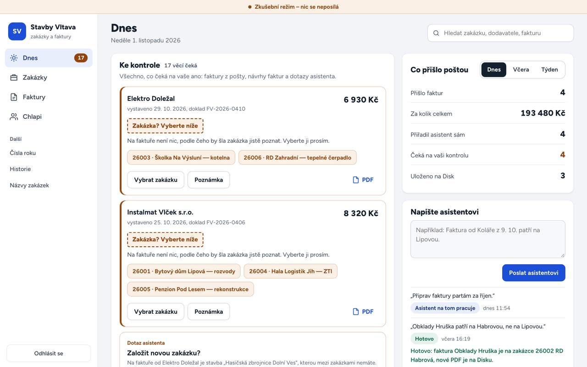

# Construction Back-office

Supplier invoices and the crews' hours land in one overview every morning, already sorted to the right job. The owner only checks and approves — no more evenings spent on paperwork.

**For:** construction and trades companies.

---

Screenshots use invented data. This is a portfolio entry — the product itself is not public. 
Want something like this for your company? → [autevio.cz](https://autevio.cz) · [modernikomunikace.com](https://modernikomunikace.com) · [← Karel Chyška](https://github.com/KChyska)
